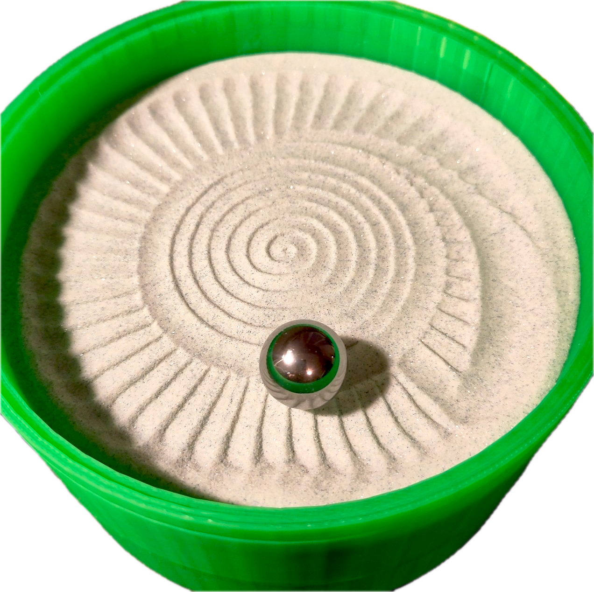

# mini-sandtable-polar-esp32
Control for a polar coordinate sandtable, using an ESP32

## Project log
1. [Idea and early concept](docs/project%20log/part1-introduction.md): objectives, requirements and subsystems
2. [First prototype](docs/project%20log/part2-first-prototype.md): Raspberry Pi, motor HAT and 28BYJ-48 motors
3. [Second prototype](docs/project%20log/part3-second-prototype.md): ESP32, A4988 drivers and NEMA17 motors
4. [Third prototype](docs/project%20log/part4-third-prototype.md): ESP32, ULN2803 and 28BYJ-48 motors
5. [Refinements and conclusions](docs/project%20log/part5-refinements.md): sand, ball sizes, speed improvements and comparison of builds

## Docs
- [PlatformIO usage](docs/platformio-usage.md): building, uploading, adding `.thr` patterns, serial monitor and tests
- [Software design](docs/software_design.md)
- Electrical hardware: see the wiring and BOM for each build in [part 3](docs/project%20log/part3-second-prototype.md#electrical-design) (A4988 / NEMA17) and [part 4](docs/project%20log/part4-third-prototype.md#electrical-design) (ULN2803 / 28BYJ-48)
