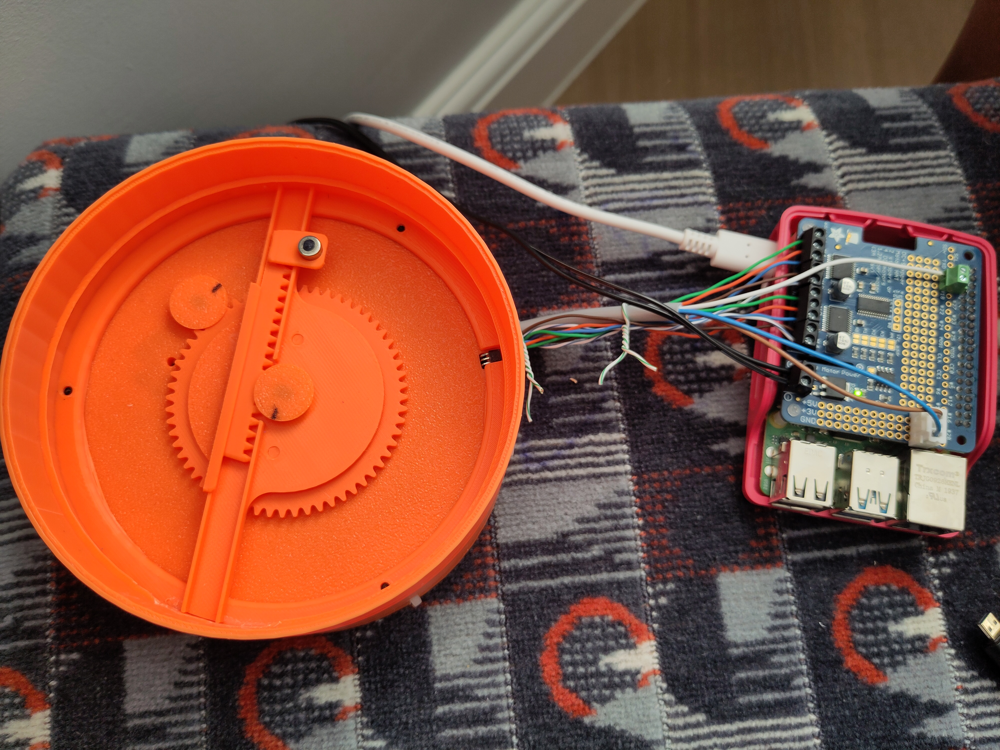
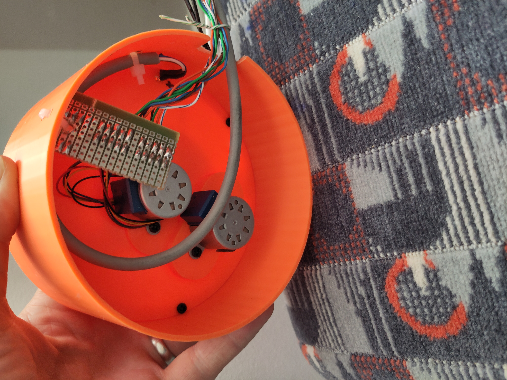
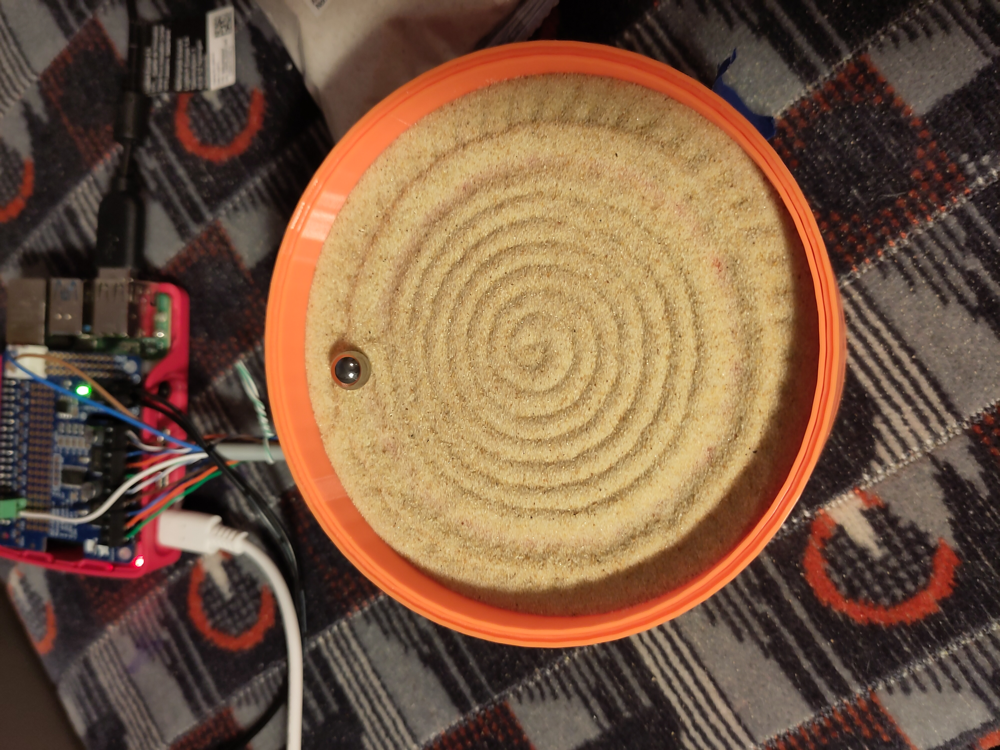

# Starting to design and first prototype

Having decided that I wanted to build a polar mechanism, I started my CAD design for the 3D-printed parts using [Onshape](https://www.onshape.com/en/), an online parametric CAD design package, and (at the time of writing) [free for non-commercial use](https://www.onshape.com/en/products/free). As I am not an experienced CAD designer, it was also helpful that they provide a number of [tutorials on their website](https://learn.onshape.com/) to help get started.

The first design can be seen in Onshape [here](https://cad.onshape.com/documents/7ad59e3138f1813dd833a7ba/w/e3cdf864d640c5b023916b6a/e/ba935a6014cc0a75bc3e4f22).

The first prototype featured a circular sand-table bed, 113 mm in diameter, with a total external diameter of just under 120 mm. Other components used in the initial concept were as follows:

- [28BYJ-48](https://www.instructables.com/How-to-Control-28BYJ-48-Stepper-Motor-With-ULN2003/) — a cheap geared stepper motor readily available from sites like Amazon or [eBay](https://www.ebay.co.uk/sch/i.html?_nkw=28BYJ-48), for around £3 each
- [Raspberry Pi 4](https://www.raspberrypi.com/products/raspberry-pi-4-model-b/) — £33–158(!)
- [Adafruit RPi Motor HAT](https://thepihut.com/products/adafruit-dc-stepper-motor-hat-for-raspberry-pi-mini-kit) — £22
- A3144 unipolar Hall-effect sensor for homing — £0.48 each
- 8 mm steel ball bearings
- Neodymium magnets — N52 6 x 3 mm disc
- Various sand options from different sources

I already had the Raspberry Pi from previous projects, so I purchased the motor HAT and other components to use with it. The Raspberry Pi was also an easy way to get started quickly, allowing me to write the code in Python, a language I was already somewhat familiar with. Having a full operating system on the Pi (Raspberry Pi OS) was also advantageous, providing easy file management and the ability to remotely control the device, interactively starting and stopping scripts while testing and debugging.

The mechanism uses a 60-tooth gear for the theta axis and 10-tooth drive gears, giving a 6:1 reduction. The larger gear was sized such that it would allow theta motor placement away from the centre of the assembly, where the rho motor is instaled, whilst also being an easily divisable gear ratio between the two axis. Because the linear axis is fixed on top of the rotating assembly, the rho motor must step every time the theta motor steps (1 rho step for 6 in theta, given the larger theta gear ratio) to maintain the correct relative position and avoid rho drifting in or out as the theta axis moves.

Initial build and testing was undertaken circa June 2025

## First prototype lessons learned

- Very slow
    - Python — checked and was fully executing around 1ms, cyclically, however in order to drive the steppers fast enough this would need to be improved.
    - Motor HAT update — stepper control uses ICs capable of partial stepping using PWM. Partial stepping can be disabled, but the communication rate between the ICs on the HAT is limited by this.
    - Reducer gear ratio 64:1 on the stepper motor requires many steps for small distances moved (2048 steps for a full rotation)
- Jumpy ball movement — not sure whether this is the coarseness of the sand, the uneven 3D-printed surface caused by a monotonic top layer, or the pull of the magnet (too weak or too strong)
- Raspberry Pi is expensive and too large to realistically fit into the small footprint — the [Pi Zero](https://www.raspberrypi.com/products/raspberry-pi-zero-2-w/) could be considered as an improvement on both aspects.

## Next steps

Given the lessons learned, in the next itteration I will make significant design changes - Considering alternative processor, motors, and some experimentation to try to get the ball rolling more smoothly through the sand.