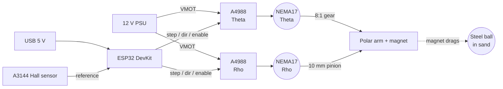
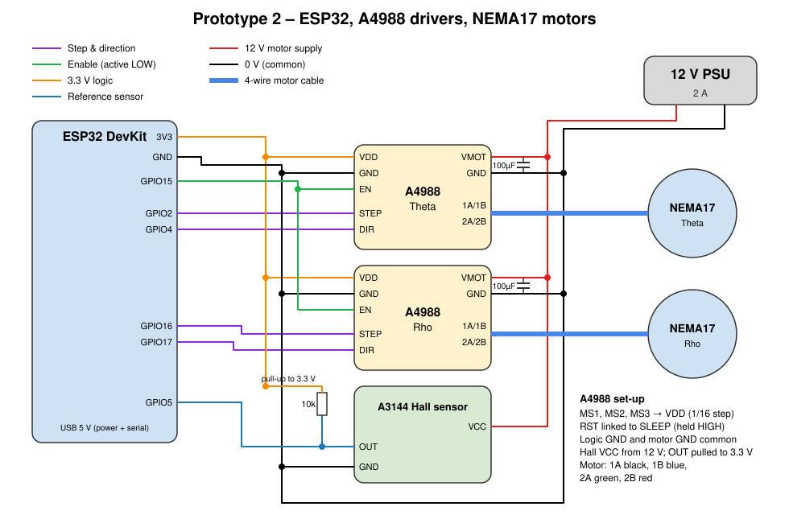
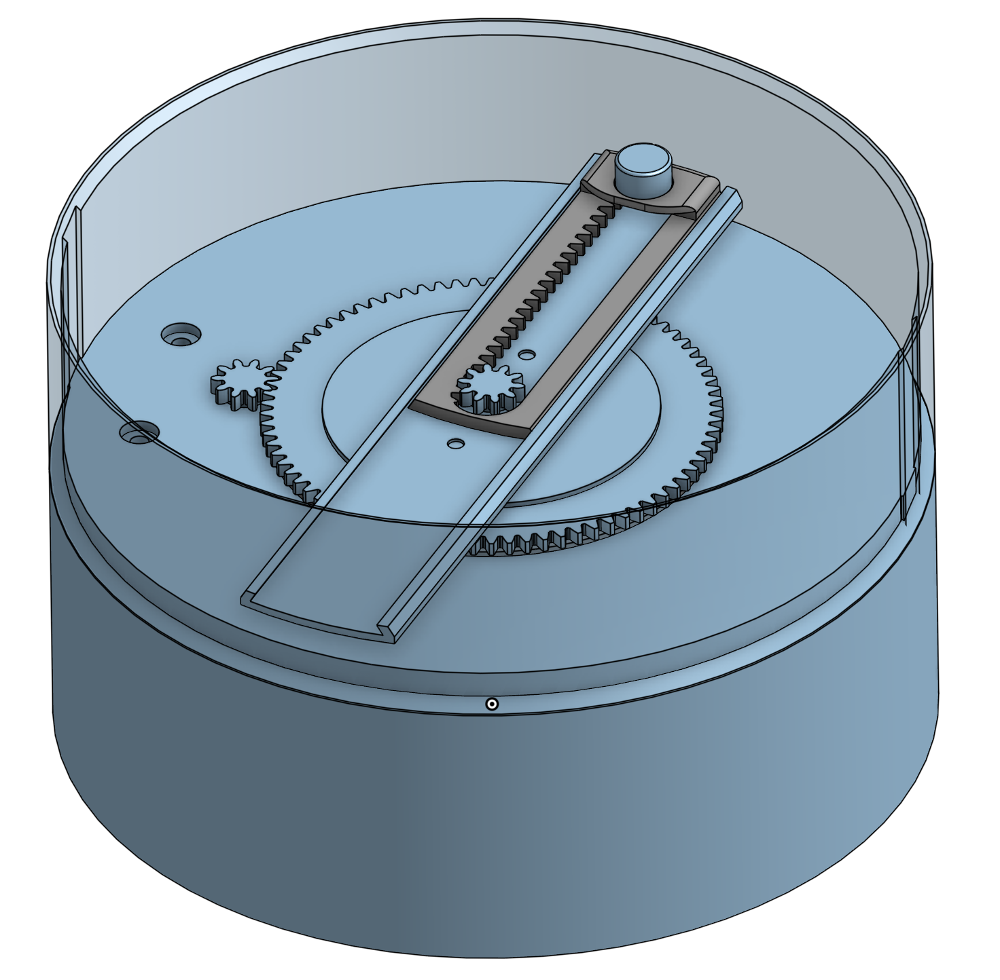
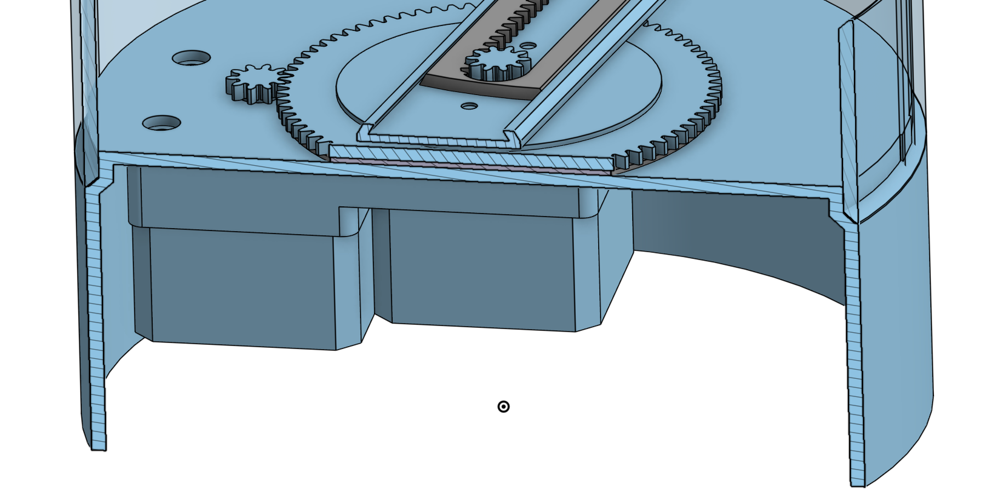
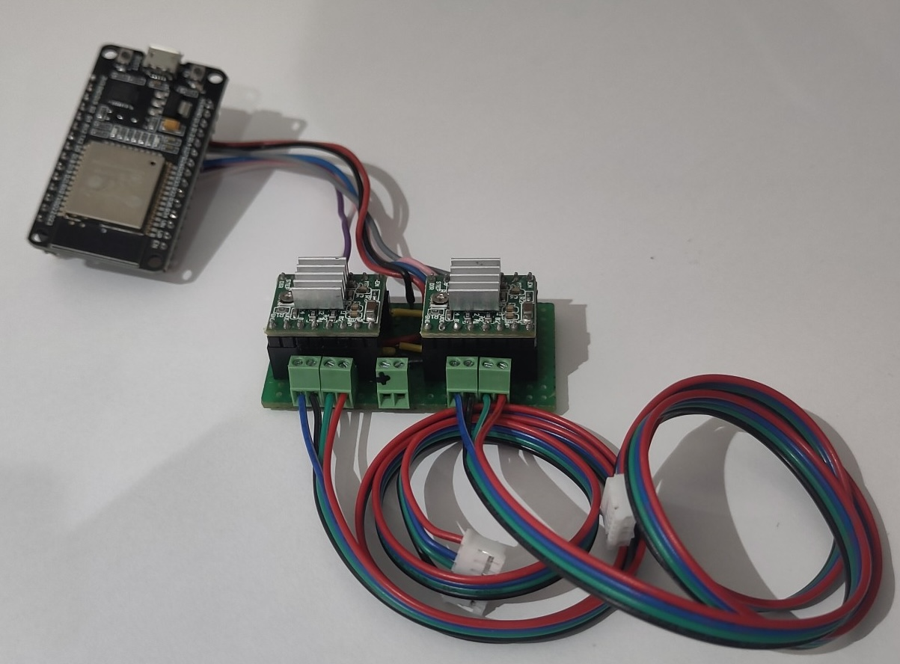
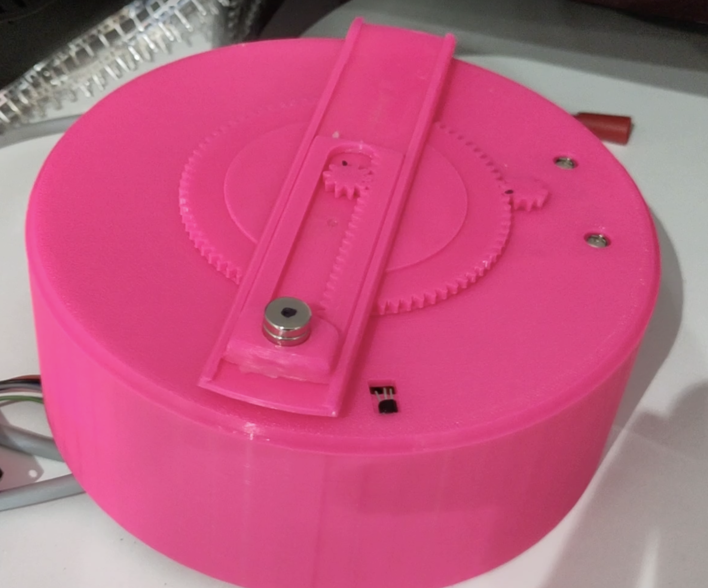
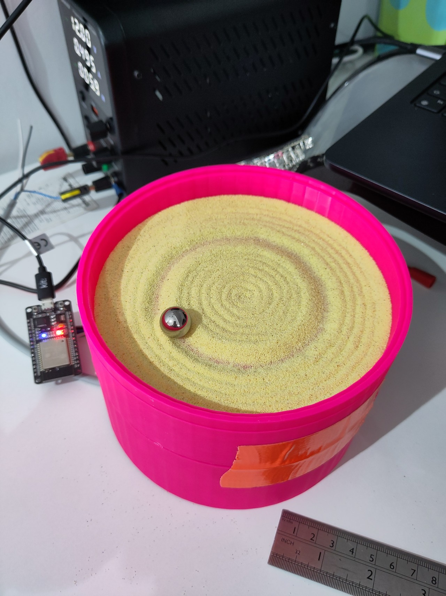

[← Part 2: First prototype](part2-first-prototype.md) | [Contents](../../README.md#project-log) | [Part 4: Third prototype →](part4-third-prototype.md)

# Second prototype — ESP32 and NEMA17 motors

The first prototype proved the basic idea worked, but it was slow, the ball movement was jumpy, and the Raspberry Pi was both too expensive and too big for the footprint. For the second prototype I changed almost everything on the electrical side:

- **Processor:** an ESP32 dev board (~£5) replaced the Raspberry Pi. It is small, cheap and fast, and moving from Python to C++ (using [PlatformIO](../platformio-usage.md)) removes the timing limits I hit on the Pi. The trade-off is losing the convenience of a full operating system for file management and remote control while testing.
- **Motors and drivers:** NEMA17 bipolar steppers driven by A4988 step/direction drivers, replacing the 28BYJ-48 and motor HAT. A dedicated step/direction driver per axis means each step is a single GPIO pulse, rather than a message over I²C.
- **Mechanism:** a new design in Onshape to fit the larger motors, with an 8:1 theta reduction.

Most of the work described here was done in October 2026.

## System layout

## Bill of materials

| Item | Qty | Unit cost | Line cost | Notes / example link |
| --- | --- | --- | --- | --- |
| ESP32 dev board (DOIT DevKit V1, 30-pin) | 1 | £5 | £5 | [Link](https://github.com/TronixLab/DOIT_ESP32_DevKit-v1_30P/tree/main) |
| A4988 stepper driver | 2 | £4 | £8 | [Link](https://www.pololu.com/product/1182) |
| NEMA17 stepper motor (17HE08-1004S, 1 A) | 2 | £5 | £10 | [Link](https://www.omc-stepperonline.com/e-series-nema-17-bipolar-1-8deg-17ncm-24-07oz-in-1a-42x42x23mm-4-wires-17he08-1004s) |
| A3144 unipolar Hall-effect sensor | 1 | £0.48 | £0.48 | [Link](https://components101.com/sensors/a3144-hall-effect-sensor) |
| 10 kΩ resistor (sensor pull-up) | 1 | ~£0.05* | £0.05 | Could also be omitted by Using the ESP32's software configurable internal pull-up |
| 100 µF electrolytic capacitor | 2 | ~£0.10* | £0.20 | One across VMOT on each driver |
| Stripboard, headers, connectors, wire | – | ~£2* | £2 | |
| 12 V 2 A power supply | 1 | £10–15 | £10–15 | |
| Neodymium magnet, 10 × 3 mm disc | 2 | £0.30 | £0.60 | |
| Steel ball bearing, 15 mm | 1 | ~£0.50* | £0.50 | |
| 3D-printed parts (PLA) | – | ~£4* | £4 | |
| **Total** | | | **~£41–46** | Within the target, and about half the cost of prototype 1 |

\* Estimated cost.

## Electrical design

The ESP32 is powered over USB, which also provides the serial connection for programming and diagnostics. The motors are powered separately from a 12 V supply into each driver's VMOT, with a 100 µF capacitor across VMOT and GND on each driver to absorb voltage spikes. The logic and motor grounds are common.

The A3144 Hall sensor is powered from the 12 V motor supply (it is rated 4.5–24 V). Its output is open-collector, so the 10 kΩ pull-up goes to the ESP32's 3.3 V rail. That keeps the signal within the ESP32 input's voltage limits.

### ESP32 pin assignments

[ESP32 DevKit pinout](https://raw.githubusercontent.com/TronixLab/DOIT_ESP32_DevKit-v1_30P/refs/heads/main/Docs/DOIT_ESP32-DevkitV1_PINOUT.png)

| ESP32 pin | Direction | Connected to |
| --- | --- | --- |
| 3V3 | – | Both drivers VDD, Hall sensor pull-up |
| GND | – | Both drivers GND, Hall sensor GND, PSU 0 V |
| GPIO15 | Out | Both drivers ENABLE (active LOW) |
| GPIO2 | Out | Theta driver STEP |
| GPIO4 | Out | Theta driver DIR |
| GPIO16 | Out | Rho driver STEP |
| GPIO17 | Out | Rho driver DIR |
| GPIO5 | In | Hall sensor OUT (active LOW, 10 kΩ pull-up to 3.3 V) |

Note with hindsight, there are certain pins best to avoid for certain functions described in detail [here](https://lastminuteengineers.com/esp32-pinout-reference/), so would be better to chose alternatives to 2,4,5 and 15!

### A4988 set-up

A useful reference: [Control Stepper Motor with A4988 Driver Module & Arduino](https://lastminuteengineers.com/a4988-stepper-motor-driver-arduino-tutorial/).

- Microstepping is set with the MS1–MS3 pins, which are LOW by default (full step). I started at ¼ stepping (MS2 HIGH @ 3.3 V), then moved to 1/16 stepping (MS1, MS2 and MS3 all HIGH) to reduce noise — see lessons learned below.
- RST is held HIGH (linked to SLEEP), as that feature isn't used.
- Motor wiring: 1A black, 1B blue, 2A green, 2B red.

## Mechanical design

The design for prototypes 2 and 3 can be seen in Onshape [here](https://cad.onshape.com/documents/a0c67e172333e1dc4ee2a0a1/w/b964a80dd33fbf93d01219cb/e/df1cbf4bf7a323954b10a3b2) V2.

- **Assembly dimensions** Assembly outer diameter 157 mm, sand area diameter 147 mm. Total height ~102 mm.
- **Theta axis:** 8:1 reduction from the motor drive gear to the main theta gear. With 1.8° steps and 1/16 microstepping, one microstep moves the arm about 0.014°.
- **Rho axis:** driven by a 10 mm pinion, so each full motor step moves the magnet carriage π × 10 mm × (1.8° / 360°) ≈ 0.157 mm (≈ 0.0098 mm per microstep). Usable travel is 0–66.5 mm from the centre.
- **Axis coupling:** as in the first prototype, the rho mechanism rides on the rotating theta assembly, so rho must step once for every 8 theta steps to stop the carriage drifting in or out as theta rotates. Getting this coupling into the software was one of the first bugs to fix.
- **Theta gear support:** the main theta gear was initially supported on a small washer and was quite unstable, tipping as it rotated. I printed an 80 mm washer to sit underneath it, which controlled the tipping whilst testing, but would later be designed out, with the gear running directly against the support platform.
- **Homing:** the A3144 Hall-effect sensor is glued in place under the path of the magnet carrier, so the magnet triggers it at the reference position. A cutout is provided in the design for consistency of positioning.

## Software

The software was rewritten from scratch in C++ for the ESP32 — see [Software design](../software_design.md) for the class structure (motor control, motion planner and mover). The main changes during this prototype were:

- **Bug fixes:** the 8:1 gearing and theta–rho coupling were missing from the planner, and the total move time calculation could go negative and was then being assigned from a float into an `unsigned long` field.
- **Speed sweep:** a temporary test program stepped the theta motor at decreasing delays (15 ms down to 1 ms) to find the limits. Using `millis()`, and worked well down to 1 ms, and an oscilloscope check confirmed the pulse widths and delays were as expected.
This was later repeated using delays in microseconds `micros()` to find the actual limits of the setup and motors.
- **Microsecond timing:** moving to 1/16 microstepping meant step timing had to move from `millis()` to `micros()`.
- **Homing routine:** the first version simply stopped as soon as the sensor triggered. It was then improved to a multi-stage sequence:
    1. Rotate theta until the sensor is found
    2. Continue past until the sensor turns off
    3. Reverse back until the sensor turns on again
    4. Take the centre of the sensor between the forward and reverse edges
    5. Retract rho until the sensor turns off
    6. Drive rho forward until the sensor turns on again — this is zero
- **Theta reset between patterns:** each pattern starts at theta = 0, so after finishing a pattern that had wound several turns, the table would unwind all the way back before starting the next one. A `reset_theta_position()` call at the start of `play_pattern()` now removes the whole rotations first.

## Build photos and video

[Second prototype referencing video](./media/proto2_referencing.mov)

## Lessons learned, issues and fixes

- **Much faster.** The ESP32 and step/direction drivers removed the speed limits of the Pi and motor HAT.
- **Noisy.** The assembly was noisy when moving, from both the motors and rattling 3D-printed parts. Running at 1/16 microstepping and adding vaseline to the rho slide and under the theta gear reduced the noise significantly, but the NEMA17 motors themselves remained quite noisy. Alternatively could use PTFE grease.
- **TMC2209 drivers didn't work out (yet).** I bought a pair of TMC2209s as a "silent" drop-in replacement for the A4988s, but couldn't set the current limit using VREF and the potentiometer. On one board the potentiometer rotated continuously with no effect on VREF; the other could only be adjusted between 0 and 0.165 V rather than the expected 0–2.5 V. These boards can also be configured via UART, but dpong this was not explored further at this stage.
- **Jumpy ball.** The ball still moved jerkily through the sand. The next thing to try was finer sand — see [part 5](part5-refinements.md).
- **Upper assembly.** The upper mechanical parts (sand tray and middle riser) don't interlock properly so rotate as the ball drags through the sand.

### Side experiment: 28BYJ-48 on the A4988

To compare against the NEMA17s, I re-tested the 28BYJ-48 motors on the A4988 drivers. The 28BYJ-48 is unipolar and the A4988 is a bipolar driver, so the motor needed a modification: removing the blue cover and scratching through the PCB trace that joins the two coils at the centre tap. After the modification, the coil pairs are blue/yellow and brown/black, with red left disconnected.

With microstepping disabled for maximum speed, the frequency sweep showed the motors worked down to 2 ms between pulses (500 Hz) but didn't move at all at 1 ms (1 kHz). At 2048 steps per revolution due to it's own internal gearbox, that is just over 4 s per motor revolution, or around 32 s per full theta rotation through an 8:1 gear. By comparison, the NEMA17 has 200 full steps per revolution, so even at a relaxed 10 ms per step a motor revolution takes only 2 s.

## Next steps

- The NEMA17 build works, including ESP32 control and software re-write, but it is noisy for something designed to sit on a desk and run continuously.
- Quieter options are a working TMC2209 set-up, or going back to the 28BYJ-48 with a better way to drive a unipolar stepper — ULN2003 (7 channel x2) or ULN2803 (8 channel) darlington array — and a faster theta gear ratio.
- I bought ULN2803 chips, TMC2209 drivers and PTFE grease to try these, which led to the [third prototype](part4-third-prototype.md).

---

[← Part 2: First prototype](part2-first-prototype.md) | [Contents](../../README.md#project-log) | [Part 4: Third prototype →](part4-third-prototype.md)
