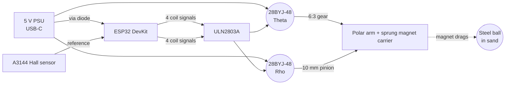
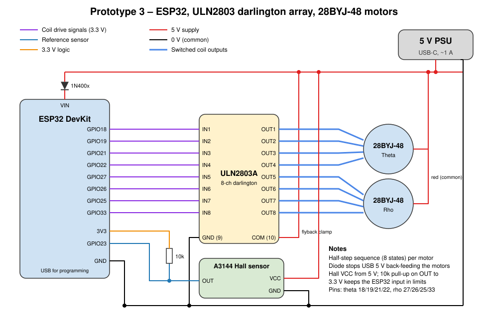
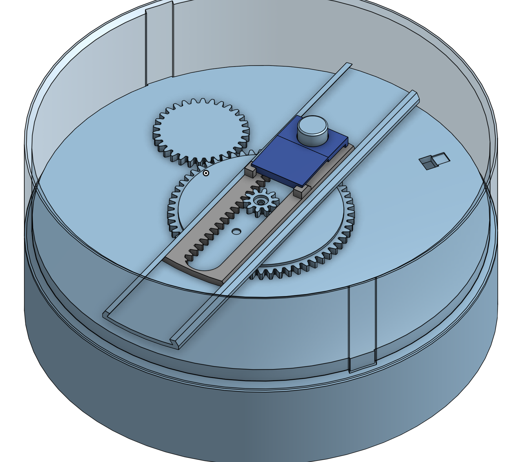
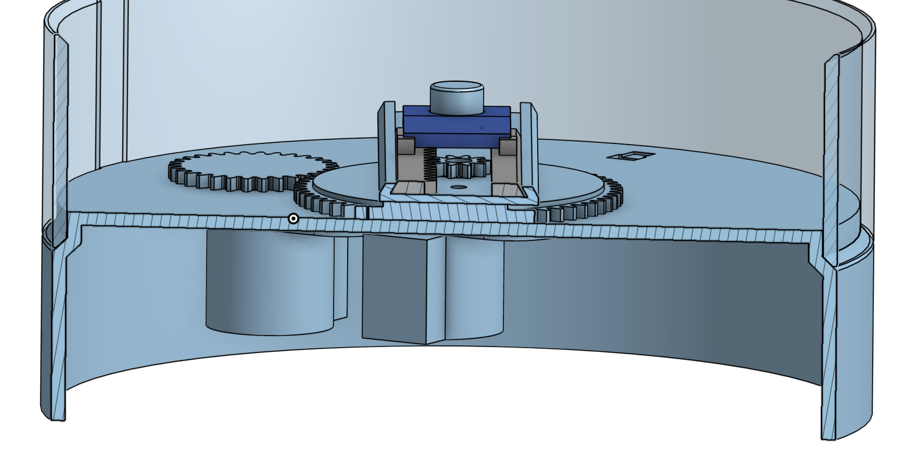
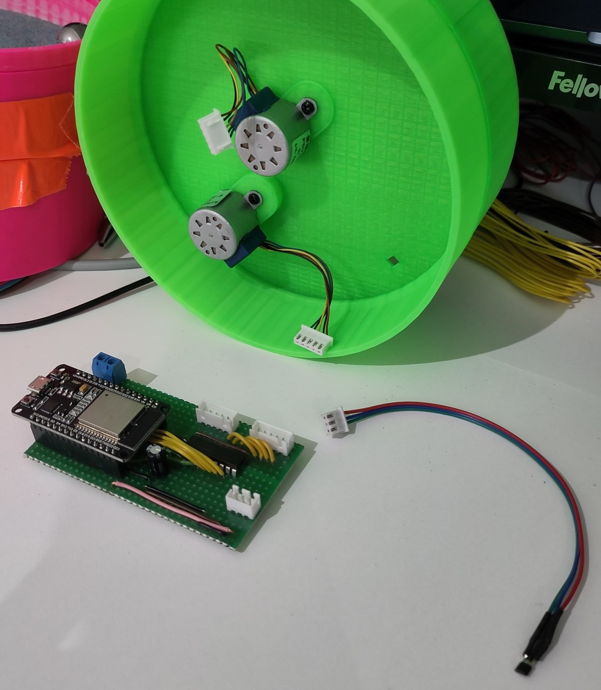
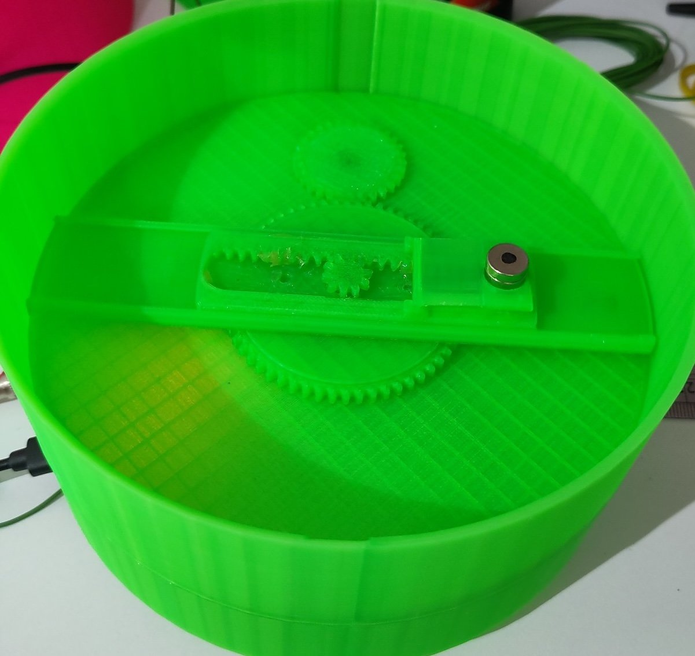
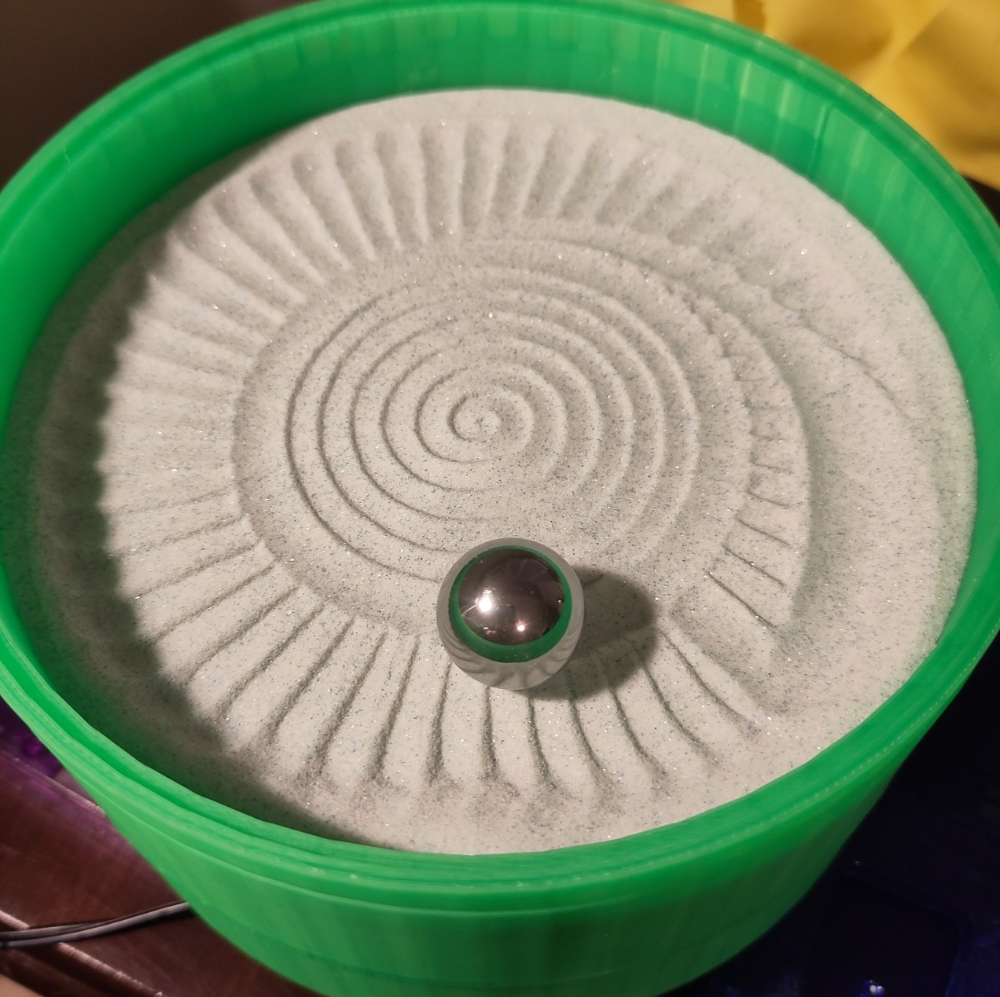

[← Part 3: Second prototype](part3-second-prototype.md) | [Contents](../../README.md#project-log) | [Part 5: Refinements and conclusions →](part5-refinements.md)

# Third prototype — ESP32 and 28BYJ-48 motors

The second prototype was fast but noisy. With the TMC2209 "silent" drivers not working out, I went back to the cheap, quiet 28BYJ-48 geared steppers from the first prototype, this time driven directly from the ESP32 through a ULN2803 darlington array. The aim was the lowest-cost, quietest version of the table, accepting that it would be slower.

Why the ULN2803:

- It is like the ULN2003 commonly sold on driver boards with the 28BYJ-48, but has 8 channels rather than 7, so **one chip can drive both motors** (4 coils each). This is a common setup for driving unipolar stepper motors such as 28BYJ-48.
- It costs around £0.30, compared with ~£4 for an A4988.
- The trade-off is that the ESP32 needs 4 output pins per motor, and the software must drive the coils in the correct sequence itself. A shift register such as a 74HC595 could reduce the pin count, but the ESP32 has enough spare pins.

I first built a proof-of-concept on a breadboard, half-stepping one 28BYJ-48 at 2 ms per step. The speed was OK (and could be improved with gearing), it worked well, and it was relatively silent, so I went ahead with the third prototype in November 2026.

## System layout

## Bill of materials

| Item | Qty | Unit cost | Line cost | Notes / example link |
| --- | --- | --- | --- | --- |
| ESP32 dev board (DOIT DevKit V1, 30-pin) | 1 | £5 | £5 | [Link](https://github.com/TronixLab/DOIT_ESP32_DevKit-v1_30P/tree/main) |
| ULN2803A darlington array | 1 | £0.30 | £0.30 | 8 channels: drives both motors |
| [28BYJ-48](https://www.ebay.co.uk/sch/i.html?_nkw=28BYJ-48) geared stepper motor (5 V) | 2 | £3 | £6 | |
| A3144 unipolar Hall-effect sensor | 1 | £0.48 | £0.48 | |
| 10 kΩ resistor (sensor pull-up) | 1 | ~£0.05* | £0.05 | |
| Diode (1N400x or similar) | 1 | ~£0.05* | £0.05 | Stops the ESP32 back-feeding the motor supply, since both are 5V  |
| 100 µF electrolytic capacitor | 1 | ~£0.10* | £0.10 | Across the 5 V supply |
| Stripboard, headers, connectors, wire | – | ~£2* | £2 | |
| USB-C power input board | 1 | ~£1* | £1 | |
| 5 V 1 A power supply | 1 | £10–15 | £10–15 | Or use an existing USB-C power supply |
| Neodymium magnet, 10 × 3 mm disc | 2 | £0.30 | £0.60 | |
| Steel ball bearing, 20 mm | 1 | ~£2.00* | £2.00 | |
| 3D-printed parts (PLA) | – | ~£4* | £4 | |
| **Total** | | | **~£32–37** | The cheapest build so far. The power supply is now the largest single cost |

\* Estimated cost.

## Electrical design

Everything runs from a single 5 V supply, which powers the motors (through their red common lead), the ULN2803's COM pin (its internal flyback clamp diodes), the Hall sensor, and the ESP32 through its VIN pin. A 100 µF capacitor across the 5 V supply and 0 V smooths the voltage dips and spikes caused by the motor coils switching. As in prototype 2, the Hall sensor's 10 kΩ pull-up goes to the ESP32's 3.3 V rail, not the 5 V supply, so the input never sees more than 3.3 V. A diode in series with VIN stops the ESP32 powering the motors from its USB connection when it is plugged in for programming. It also means that switching off the external supply works as a simple emergency stop — the motors stop while the ESP32 keeps running.

I chose to use JST-XH (2.54mm pin spacing) connectors for the motors and hall effect sensors, for easy disconnection from the board.

### ESP32 pin assignments

Some ESP32 GPIOs are best avoided (strapping pins, flash pins and input-only pins — see [this ESP32 pinout reference](https://lastminuteengineers.com/esp32-pinout-reference/)), so the pins were chosen as follows:

| ESP32 pin | Direction | Connected to |
| --- | --- | --- |
| VIN | In | 5 V supply via diode |
| GND | – | 0 V common |
| 3V3 | – | Hall sensor pull-up |
| GPIO18, 19, 21, 22 | Out | ULN2803 IN1–IN4 → theta motor coils |
| GPIO27, 26, 25, 33 | Out | ULN2803 IN5–IN8 → rho motor coils |
| GPIO23 | In | Hall sensor OUT (active LOW, 10 kΩ pull-up to 3.3 V) |

The motors are half-stepped using an 8-state coil sequence, giving 4096 steps per output shaft revolution (64 steps × 64:1 gearbox).

## Mechanical design

The design for prototypes 2 and 3 can be seen in Onshape [here](https://cad.onshape.com/documents/a0c67e172333e1dc4ee2a0a1/w/b964a80dd33fbf93d01219cb/e/df1cbf4bf7a323954b10a3b2) V4.

- **Motor mounts:** the NEMA17 design was reworked to fit the 28BYJ-48 motors again.
- **Theta gear ratio:** the 8:1 theta reduction used with the NEMA17 would make the 28BYJ-48 far too slow, so I looked at 2:8 (1:4), 3:6 (1:2) and 4:4 (1:1). Smaller main gears give less support for the rotating assembly, so stability had to be considered too. With a 2 ms minimum step time (500 steps/s), the steps needed for a given theta speed were:

    | Ratio | Steps per output degree | 5°/s | 10°/s |
    |-------|-------------------------|------|-------|
    | 1:1 | 11.38 | 56.9 steps/s (17,578 µs/step) | 113.8 steps/s (8,789 µs/step) |
    | 1:2 | 22.76 | 113.8 steps/s (8,789 µs/step) | 227.6 steps/s (4,395 µs/step) |
    | 1:4 | 45.51 | 227.6 steps/s (4,395 µs/step) | 455.1 steps/s (2,197 µs/step) |
    | 1:8 | 91.02 | 455.1 steps/s (2,197 µs/step) | 910.2 steps/s (1,099 µs/step) |

    The 6:3 (2:1) ratio was chosen, which comfortably allows 5–10°/s. At around 57.3 mm from the centre, 1° of rotation moves the ball about 1 mm, so this is close to 5–10 mm/s at the outer edge.
- **Axis coupling:** with the 2:1 theta ratio, rho now steps once for every 2 theta steps.
- **Rho speed:** with the 10 mm pinion, one half-step moves the carriage π × 10 mm / 4096 ≈ 0.0077 mm. At the 2 ms minimum step time that is a maximum of about 3.8 mm/s, so rho speed is set to 3.5 mm/s.
- **Sprung magnet carrier:** I designed a new spring mechanism for the magnet arm. <!-- TODO: add a line on what the spring does, e.g. keeps the magnet pressed up to the underside of the tray -->
- **Hall sensor mounting:** the sensor sits in a 4.5 mm cut-out, which was a tight fit for the pins with heatshrink on. After homing, the carriage is offset 6 mm from the sensor (increased from 5 mm, as it was hitting the end of travel).

## Build photos and video

- [Third prototype - referencing video](media/proto3_referencing.mov)
- [Third prototype - pattern video](media/proto3_pattern.mov)
- [Third prototype - patterns timelapse](media/proto3_timelapse.mov)

## Lessons learned, issues and fixes

- **Quiet.** With some PTFE grease on the moving parts, this version is very quiet and works well.
- **Missed pull-up.** Electrical checks before connecting the motors, ESP32 and sensor (continuity and voltages at the right points) found that I had left out the Hall sensor's pull-up resistor — easily added.
- **Sensor false trigger when the supply is off.** The hall effect sensor is powered from the external supply and is active-low, so when the external supply is switched off but the ESP32 is still powered over USB, the ESP32 reads the input as LOW and thinks the reference has been found. Whilst this is an issue when working with the ESP32 powered from USB, it will not be an issue in normal operation.
- **Motor directions.** Forward for both motors turns out to be counter-clockwise. That is fine for theta, as the drive gear reverses it to a clockwise arm motion, but rho needed inverting, because a clockwise motor drive pushes the arm outward.
- **Rho not travelling its full stroke.** The serial diagnostics showed rho being driven faster than the 2 ms minimum step time, so it was missing steps. The 5 mm/s rho speed needed 652 steps/s (1.53 ms per step), so I reduced it to 3.5 mm/s.
- **Stopping on the third pattern.** When looping through patterns (a file pattern, then radial sweep, then spiral), the table would sometimes stop part-way through the third pattern, at no consistent point. This was traced to a timer value wrapping around in the mover, which caused it to hang, and was fully resolved by updating the timing code (along with some other timing fixes at the same time).
- **Pattern files.** Loading `.thr` files from the ESP32's filesystem worked well. More patterns were added from the [Dune Weaver repository](https://github.com/tuanchris/dune-weaver/tree/main/patterns).
- **Slightly jerky, but good enough.** The ball movement is still a little jerky, but it draws patterns well. For an ultra-low-cost build, that is good enough.

## Next steps

- **Smoother transitions between patterns:** check that the theta reset and transition moves work correctly, and choose to move forwards or backwards depending on the shortest route.
- **Power input:** mount the USB-C power board in the body, using an off-the-shelf 5 V 1 A supply.
- **Controls:** consider adding an external reset or start/stop button.
- **PCB:** use the wiring diagram as a starting point for a custom PCB. Many 28BYJ-48 motors are sold with 5-pin JST XH (2.54 mm pitch) connectors, so a PCB could have those fitted. An RP2040 (around £4) could be an alternative microcontroller, though it has 2 MB of onboard flash compared with the ESP32's 4 MB, so would likely also need external storage. This wasn't part of the original scope, but is a nice-to-have, saving on stripboard soldering if replecating the design in future.
- **Speed:** try additional gearing to speed up the 28BYJ-48 — see [part 5](part5-refinements.md).

---

[← Part 3: Second prototype](part3-second-prototype.md) | [Contents](../../README.md#project-log) | [Part 5: Refinements and conclusions →](part5-refinements.md)
