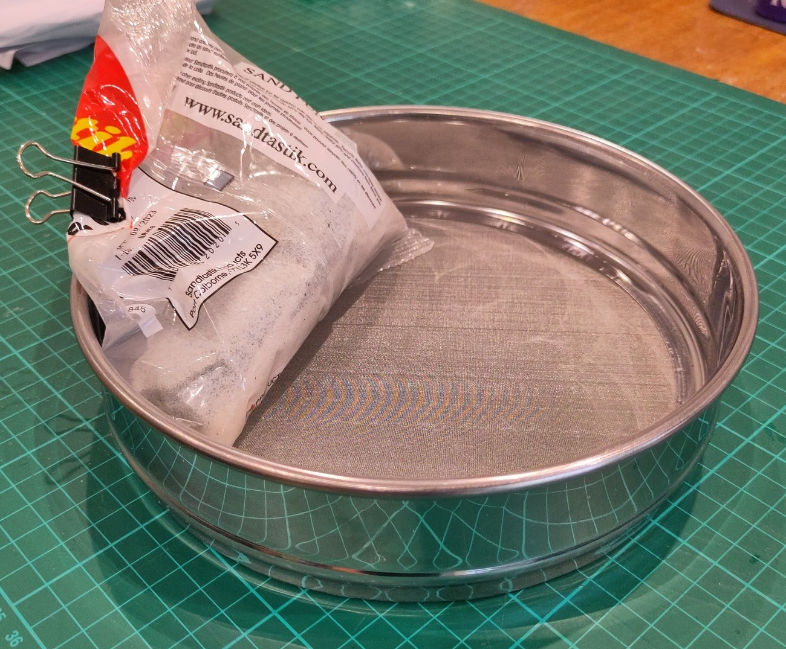

[← Part 4: Third prototype](part4-third-prototype.md) | [Contents](../../README.md#project-log)

# Refinements and conclusions

With two working builds — the faster NEMA17 table from [part 3](part3-second-prototype.md) and the quiet, low-cost 28BYJ-48 table from [part 4](part4-third-prototype.md) — the last round of work focused on how the ball moves through the sand, and on how fast each build could go. Both builds now share one codebase, selected with a PlatformIO environment (`esp32-a4988` or `esp32-uln2803`, see [PlatformIO usage](../platformio-usage.md)).

## Sand, balls and magnets

The jumpy ball movement had been a problem since the first prototype. Possible causes were the coarseness of the sand, the uneven 3D-printed surface, and the strength of the magnet.

- **Sand:** I sieved the sand through a 0.15 mm sieve to make it much finer, this showed a reasonable improvement
- **Magnets:** two 10 × 3 mm neodymium disc magnets stacked together.
- **Ball size:** I compared 15 mm and 20 mm steel balls.
    - The 20 mm ball was a little smoother, but in deeper sand it tended to float on top rather than cut through, and it has more resistance in the sand. On a couple of occasions it lost coupling with the magnet.
    - On the 28BYJ-48 build, the 20 mm ball was slightly smoother and seemed to work well.
    - On the faster NEMA17 build, the 15 mm ball worked well. A 20 mm ball would need a stronger magnet, particularly at higher speeds.
- **Speed:** I also noted on other sand table projects, usually larger, the mechanism tends to move faster making and jerking less obvious. See the speed headings below for more details.

## Speeding up the 28BYJ-48: 5:1 gearbox

To get more speed from the 28BYJ-48, I modelled and printed a 5:1 step-up gearbox driven by the motor. It worked, but torque was limited and the gearbox, with grease, added additional resistance. Ultimately it only reached about 17 mm/s, well short of the 50–100 mm/s I was hoping for, so I didn't take it further.

## Speeding up the NEMA17

I set up the NEMA17 hardware again on a second ESP32 and reworked the software to drive it much faster:

- **Minimum step delay** reduced from milliseconds to 50 µs, with a short (3 µs) step pulse, and timing fixes to remove other constraints that had been tuned for the slow motors.
- **Acceleration ramp:** at these speeds the motors skipped steps if asked to start at full speed, so the planner now ramps up from a start rate (800 steps/s) at 20,000 steps/s². Long moves are split into segments of at most 50 steps, so the ramp builds over the segments rather than a long move starting at full speed.
- **Tested speeds** up to 80 mm/s on rho and 80°/s on theta (with 1/16 microstepping, that is roughly 8,000 and 5,700 steps/s).

This worked well, and the faster ball movement did seem smoother, even with the 15 mm ball. However, it was still noisy — noisier than I'd want running continuously on a desk.

- [Speed increase on NEMA17 assembly - mechanism](media/refine_rapid1.mov)
- [Speed increase on NEMA17 assembly - pattern](media/refine_rapid2.mov)

## Conclusions

| | Prototype 2: NEMA17 + A4988 | Prototype 3: 28BYJ-48 + ULN2803 |
| --- | --- | --- |
| Approx. BOM cost | ~£40–45 | ~£29–34 |
| Power supply | 12 V 2 A | 5 V 1 A |
| Top speed tested | 80 mm/s rho, 80°/s theta | 3.5 mm/s rho, 5°/s theta |
| Ball movement | Faster and smoother | Slow, a little jumpy |
| Noise | Noisy, even with 1/16 stepping and grease | Very quiet |
| Best ball | 15 mm | 20 mm |
| Electrical complexity | Two driver modules, microstepping set-up | One £0.30 chip, but 8 GPIO and coil sequencing in software |

- **28BYJ-48:** cheap and quiet, but slow, with jumpier ball movement. It meets the original goal of a BOM around £50 comfortably, and is good enough for an ultra-low-cost table.
- **NEMA17:** faster, with smoother ball movement, but noisy and a bit more expensive (though not outrageously). Still within the £100 budget.

Both builds meet the original requirements from [part 1](part1-introduction.md): circular, mostly 3D-printed, under £100 (and stretch goal <£50 !), self-homing, and looping through `.thr` patterns from the filesystem.

## Known iussues and future improvements

Whilst I now feel I have achieved what I set out to do with this project there are a few things that could be taken further:

- Mechanical/ Electrical
    - **Quieter NEMA17:** revisit the TMC2209 drivers using UART mode to set the current limit, and reduce mechanical noise with a GT2 belt or herringbone gears, PETG or nylon gears, and soft motor mounts.
    - **Stronger magnet** to use the 20 mm ball at higher speeds.
    - **Mechanical improvements:** better interlocking upper sections.
    - **Elecrical components housing:** USB-C power input mounted in the body Better housing of the interface board and ESP32 with
    - **Controls:** consider adding an external reset or start/stop button, or controlls for jogging axes.
    - **Custom PCB** based on the wiring diagrams, possibly with JST XH motor connectors, for quick, repeatable production.
- Software
    - **Constant ball speed:** modulate theta speed based on the rho position, as the ball currently travels much faster at the outer edge than near the centre.
    - **Smoother transitions between patterns**, taking the shortest route.

---

[← Part 4: Third prototype](part4-third-prototype.md) | [Contents](../../README.md#project-log)
