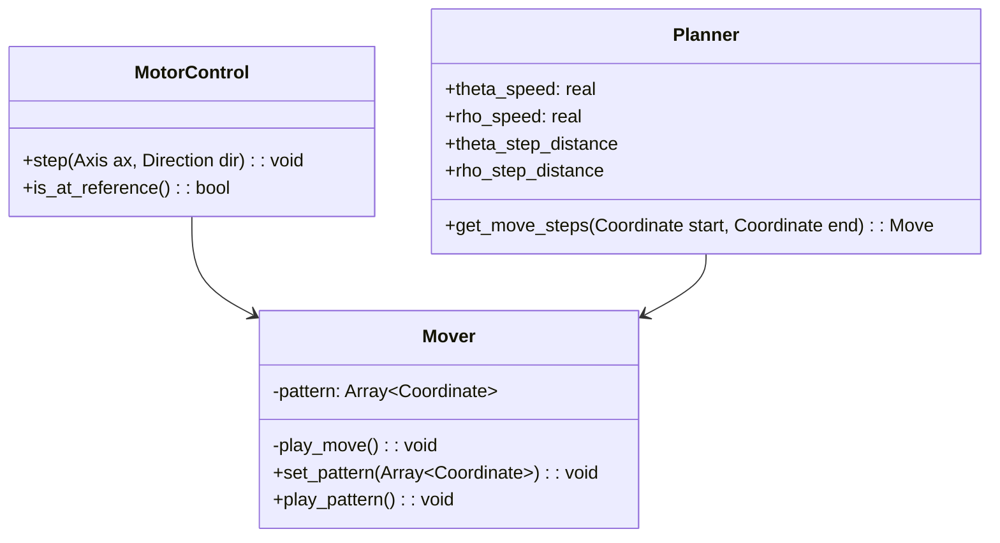
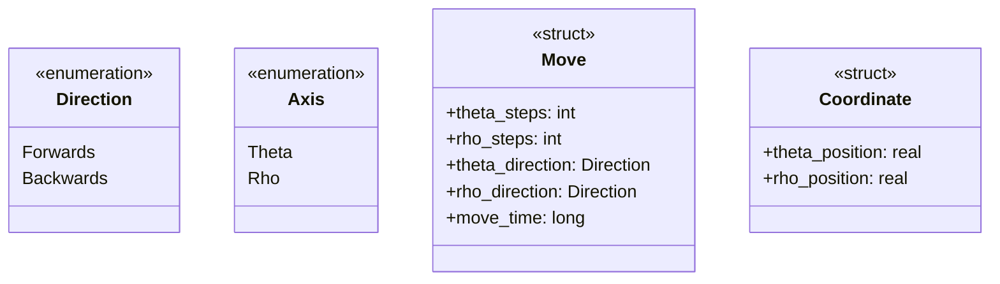
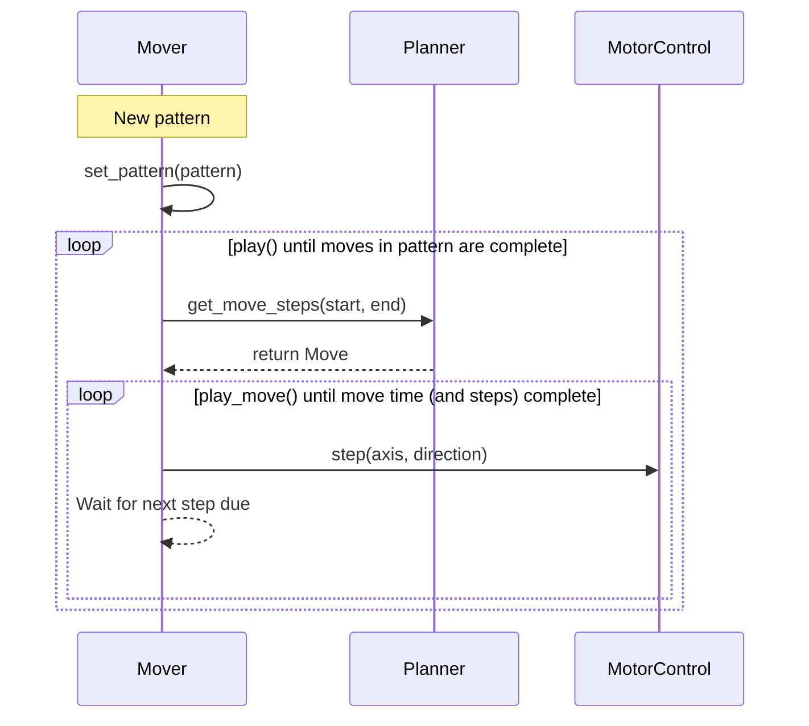
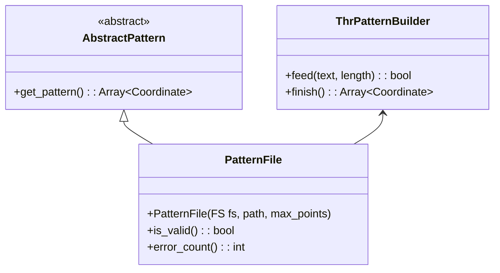

# Software design

## Class diagram

### Classes



### Structs and Enums




## Example call sequence to play pattern



## Pattern files

Patterns can be loaded from Sisyphus style theta-rho (`.thr`) files stored on the ESP32's LittleFS partition.
Put files in `data/` (e.g. `data/patterns/example_rose.thr`) and upload them with `pio run -t uploadfs`.

```
# comment
<theta radians, unwrapped> <rho 0.0 centre .. 1.0 edge>
```



- `ThrPatternBuilder` (`Pattern/thr_parser.h`) does the line splitting and parsing with no filesystem dependency, so it is unit tested on the native env (`test/native/test_pattern`). `PatternFile` itself is tested on the ESP32 (`test/embedded/test_filesystem`).
- Rho is clamped to 0..1 and scaled to `AXIS_MIN_R`..`AXIS_MAX_R`, so files work on either motor build.
- Whole rotations are removed from theta so the first point lies in [0, 2pi), avoiding extra spins to reach the start.
- Malformed lines are skipped and counted. Files over `max_points` (default 5000, ~40 KB) are rejected, as the whole pattern is held in memory.
